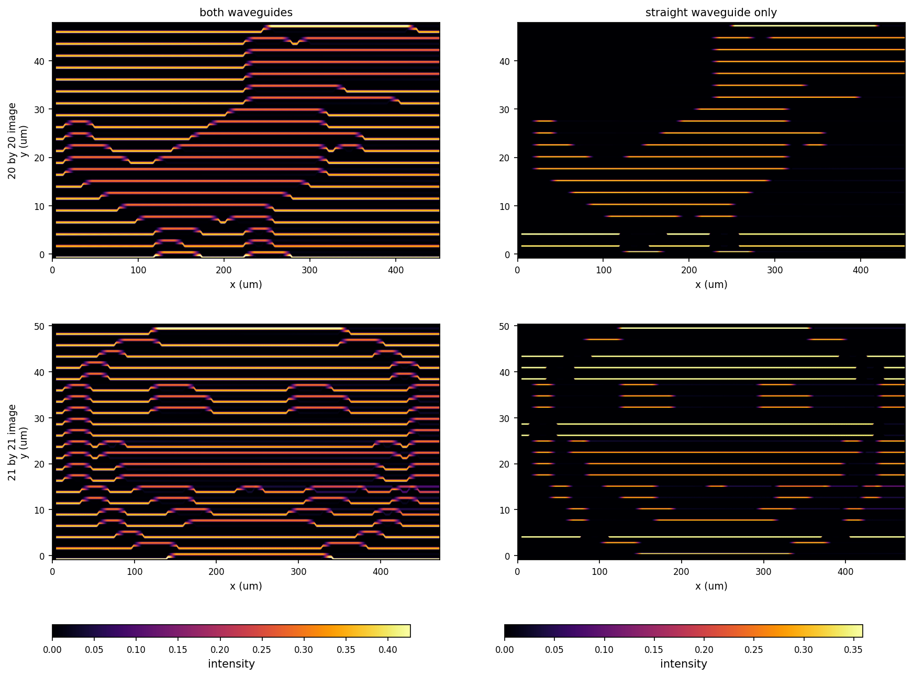

# waveguide-pixel-array

A coupled-waveguide pixel array for near-field image encoding.

A binary image is written into a photonic chip as the transverse position of
guided light. The image is read by looking at the near field above the chip.

*Top row: a 20 by 20 image. Bottom row: a 21 by 21 image. Left: the simulated
near field, both waveguides. Right: the same field with everything but the
straight waveguide masked out. Each column has its own colour bar, in units of
the input power. The image is already there in the left column; masking the
moving waveguide makes it easier to look at, and is a reading option, not a
requirement.*

## What it is

The device is a silicon-on-insulator layout. It has twenty rows and twenty
pixels in each row. One pixel is one coupling section and its two bends,
twenty-one micrometres long. The rows are 2.4 micrometres apart. The image
covers 420 by 48 micrometres. The simulated device is 452 micrometres wide; the
extra 32 micrometres are access at the two ends.

*Top: the whole device. Bottom: five pixels of the first row, where the image
changes twice. Both vertical axes are stretched, so a 0.3-micrometre waveguide is
visible against a 2.4-micrometre row spacing. Where the image stays the same the
two waveguides stay apart; where it changes, the moving waveguide is pulled in to
the coupling gap and the light changes waveguide.*

The figure is drawn from the file that `encode_image.py` writes, so it always
shows what the encoder actually produced.

Each row is a pair of waveguides. Light enters on one of them. Where the image
changes from dark to bright, or from bright to dark, the two waveguides are
brought close over one pixel, and the light swaps to the other waveguide. Where
the image stays the same, the two waveguides are kept apart and the light stays
where it is. The straight waveguide therefore carries the image, and the other
one carries its complement.

The image is not part of the shape of the chip. A microscope shows only
waveguides. Light must be coupled in, and the near field must be imaged. A
camera alone is not enough.

## Results

| | pixels correct | contrast |
|---|---|---|
| 20 by 20 image, calibrated design | 400 of 400 | 216 x |
| 21 by 21 image, calibrated design | 441 of 441 | 80.8 x |
| same, coupling length 8 % long | 441 of 441 | 241.8 x |
| same, coupling length 35 % long | 283 of 441 | 2.7 x |

With the calibrated design the two brightness groups do not overlap: the dimmest
bright pixel is 0.568 and the brightest dark pixel is 0.166, both in units of
the input power. One row leaks into its neighbour by 21.9 dB, and into rows
three or more away by 28.2 dB.

*Both panels are pixel maps of the same 21 by 21 image, on one colour scale.
Left: the coupling section at its calibrated length, 441 of 441 pixels correct,
contrast 80.8 times. Right: the same device with the coupling section 35 % too
long, 283 of 441 pixels correct, contrast 2.7 times. The 35 % run is a reference
for what failure looks like; it is not a specification.*

The pixel maps are used here, and only here, because these two states have to be
compared on one scale. The near field of figure 2 already shows the image without
any such processing.

The design rule we state, and do not claim to have validated: the critical
dimension may be off by about 23.3 divided by the number of exchanges in the row,
in nanometres, before that row starts to read wrong. It is a rule of thumb taken
from two calibration runs, not a prediction. The 35 % run is far outside its
range; it is there as a reference for what failure looks like, not as a
specification.

## Reproduce it

    python reproduce.py

That reads the files in `data/`, recomputes every number quoted above, and
prints `all checks passed`. It needs numpy and nothing else: no wave solver, no
licence, about a second.

## Encode an image

    python encode_image.py images/example.txt

This writes `out/example_geometry.json`, which holds every polygon of both
waveguides of every row, in micrometres. It needs numpy only.

    python plot_geometry.py

then draws that file and writes `figures/fig1_layout.png`, the figure at the
top of this page.

An image is a text file, one line per row, `#` for a bright pixel and `.` for a
dark one. `images/example.txt` is the 20 by 20 image used throughout;
`images/smile.txt` is the 21 by 21 one.

Figures 2 and 3 are drawn from the shipped data by:

    python plot_field_pair.py
    python make_figure.py smile smile_e350 --out figures/fig3_degraded.png

## Simulate a row

    python simulate_row.py --row 0

One row takes about twenty minutes on one processor. This step needs Ansys
Lumerical FDTD, which is commercial and needs a licence. Without it the script
says so and stops.

## Read an image back

    python read_image.py data/readout_dino.npz images/example.txt

A pixel is the mean of the intensity over the middle eight micrometres of the
pixel, taken across the straight waveguide, in units of the input power. The
middle is used so that the ramps at either end of a pixel do not enter the
number. The window and the threshold are in `parameters.json`.

## What is in here

    encode_image.py      image -> polygons
    plot_geometry.py     polygons -> the layout figure
    plot_field_pair.py   two images -> figure 2
    simulate_row.py      polygons -> one row of a wave simulation
    read_image.py        simulated data -> pixel values
    make_figure.py       the same image in two states, figure 3
    reproduce.py         every quoted number, from data/
    parameters.json      every dimension, in one place
    images/              two images
    data/                pixel values and port powers behind the figures
    figures/             the figures
    checks/              scripts used to look for weak rows and crosstalk

Every dimension the encoder and the simulation use is in `parameters.json`.

`data/` holds the per-pixel values, the port powers, and the two assembled fields
behind figure 2. The fields there are decimated by two for display, about 1.3 MB
each; the per-row field dumps they came from are 28 MB each and are not included.

## Boundaries

- The results come from a two-dimensional model.
- The design rule is for one wavelength, 1550 nanometres.
- The image is fixed at fabrication. A different image needs a different layout.
- Reading the image needs near-field or high-numerical-aperture imaging.

## Licence

Code under MIT. Data and figures under CC BY 4.0.

