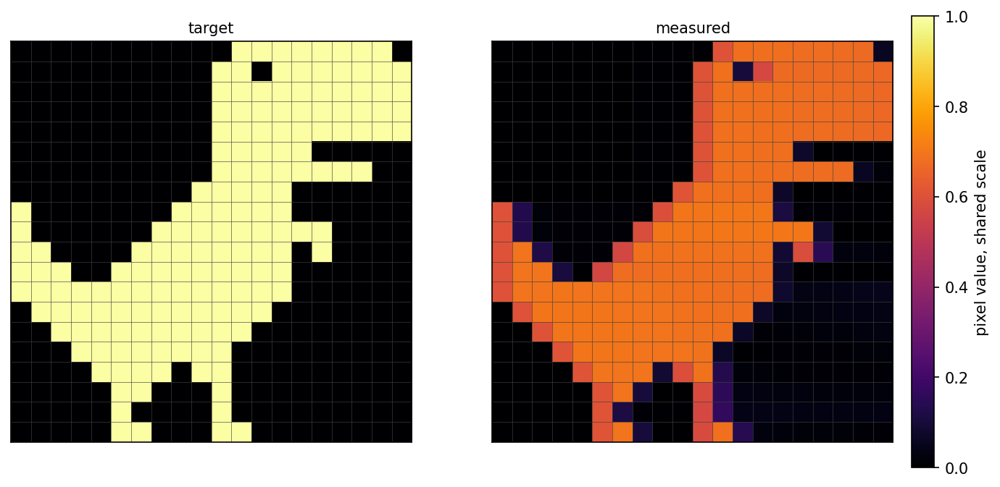

# waveguide-pixel-array

A coupled-waveguide pixel array for near-field image encoding.

A binary image is written into a photonic chip as the transverse position of
guided light. The image is read by looking at the near field above the chip.

*Top: the whole device, 452 by 48 micrometres. Bottom: five pixels of the first
row, where the image changes twice. Both vertical axes are stretched, so the
0.3-micrometre waveguides are visible against a 2.4-micrometre row spacing.
Where the image stays the same, the two waveguides stay apart; where it changes,
the moving waveguide is pulled in to the coupling gap and the light changes
waveguide.*

The figure is drawn from the file that `encode_image.py` writes, so it always
shows what the encoder actually produced.

## What it is

The device is a silicon-on-insulator layout. It has twenty rows and twenty
pixels in each row. One pixel is one coupling section and its two bends,
twenty-one micrometres long. The rows are 2.4 micrometres apart. The image
covers 420 by 48 micrometres. The simulated device is 452 micrometres wide; the
extra 32 micrometres are access at the two ends.

Each row is a pair of waveguides. Light enters on one of them. Where the image
changes from dark to bright, or from bright to dark, the two waveguides are
brought close over one pixel, and the light swaps to the other waveguide. Where
the image stays the same, the two waveguides are kept apart and the light stays
where it is. The straight waveguide therefore carries the image, and the other
one carries its complement.

The image is not part of the shape of the chip. A microscope shows only
waveguides. Light must be coupled in, and the near field must be imaged. A
camera alone is not enough.

## Results

| | pixels correct | contrast |
|---|---|---|
| 20 by 20 image, calibrated design | 400 of 400 | 216 x |
| 21 by 21 image, calibrated design | 441 of 441 | 80.8 x |
| same, coupling length 8 % long | 441 of 441 | 241.8 x |
| same, coupling length 35 % long | 283 of 441 | 2.7 x |

With the calibrated design the two brightness groups do not overlap: the dimmest
bright pixel is 0.568 and the brightest dark pixel is 0.166, both in units of
the input power. One row leaks into its neighbour by 21.9 dB, and into rows
three or more away by 28.2 dB.

*Left: the image that was encoded. Right: the pixel values that come back out of
the simulation, for the same 20 by 20 pixels. The two panels share one colour
scale, so the count of correct pixels can be checked by eye without the contrast
being normalised away. The measured values sit below 1.0 because a bright pixel
in the target is drawn as 1.0 while a measured bright pixel is 0.6 to 0.7 of the
input power.*

The full near field, both waveguides, is `figures/fig2_pattern.png`; the layout
of the same image is `figures/fig0_geometry.png`.

The design rule we state, and do not claim to have validated: the critical
dimension may be off by about 23.3 divided by the number of exchanges in the row,
in nanometres, before that row starts to read wrong. It is a rule of thumb taken
from two calibration runs, not a prediction. The 35 % run is far outside its
range; it is there as a reference for what failure looks like, not as a
specification.

## Reproduce it

    python reproduce.py

That reads the files in `data/`, recomputes every number quoted above, and
prints `all checks passed`. It needs numpy and nothing else: no wave solver, no
licence, about a second.

## Encode an image

    python encode_image.py images/example.txt

This writes `out/example_geometry.json`, which holds every polygon of both
waveguides of every row, in micrometres. It needs numpy only.

    python plot_geometry.py

then draws that file and writes `figures/fig0_geometry.png`, the figure at the
top of this page.

An image is a text file, one line per row, `#` for a bright pixel and `.` for a
dark one. `images/example.txt` is the 20 by 20 image used throughout;
`images/smile.txt` is the 21 by 21 one.

Figures 3 and 4 are drawn from the shipped data by:

    python make_figure.py dino --image images/example.txt --out figures/fig3_readout.png
    python make_figure.py smile_e350 --image images/smile.txt --out figures/fig4_degraded.png

## Simulate a row

    python simulate_row.py --row 0

One row takes about twenty minutes on one processor. This step needs Ansys
Lumerical FDTD, which is commercial and needs a licence. Without it the script
says so and stops.

## Read an image back

    python read_image.py data/readout_dino.npz images/example.txt

A pixel is the mean of the intensity over the middle eight micrometres of the
pixel, taken across the straight waveguide, in units of the input power. The
middle is used so that the ramps at either end of a pixel do not enter the
number. The window and the threshold are in `parameters.json`.

## What is in here

    encode_image.py      image -> polygons
    plot_geometry.py     polygons -> the layout figure
    simulate_row.py      polygons -> one row of a wave simulation
    read_image.py        simulated data -> pixel values
    make_figure.py       target against measurement, figures 3 and 4
    reproduce.py         every quoted number, from data/
    parameters.json      every dimension, in one place
    images/              two images
    data/                pixel values and port powers behind the figures
    figures/             the figures
    checks/              scripts used to look for weak rows and crosstalk

Every dimension the encoder and the simulation use is in `parameters.json`. The
shipped arrays in `data/` are the per-pixel values and the port powers, not the
field dumps: a single row of field data is about 28 MB, and the forty-odd rows
behind this paper would not fit in a repository.

## Boundaries

- The results come from a two-dimensional model.
- The design rule is for one wavelength, 1550 nanometres.
- The image is fixed at fabrication. A different image needs a different layout.
- Reading the image needs near-field or high-numerical-aperture imaging.

## Licence

Code under MIT. Data and figures under CC BY 4.0.
