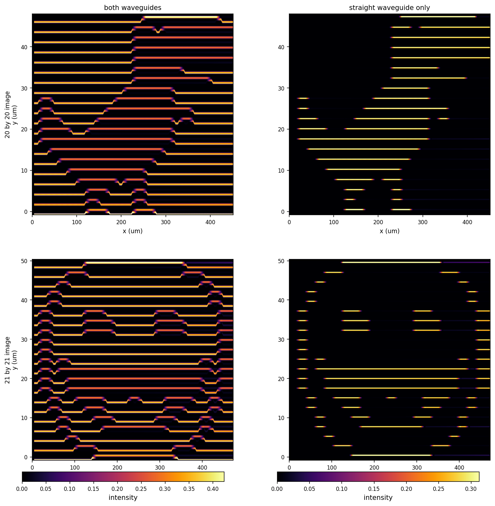
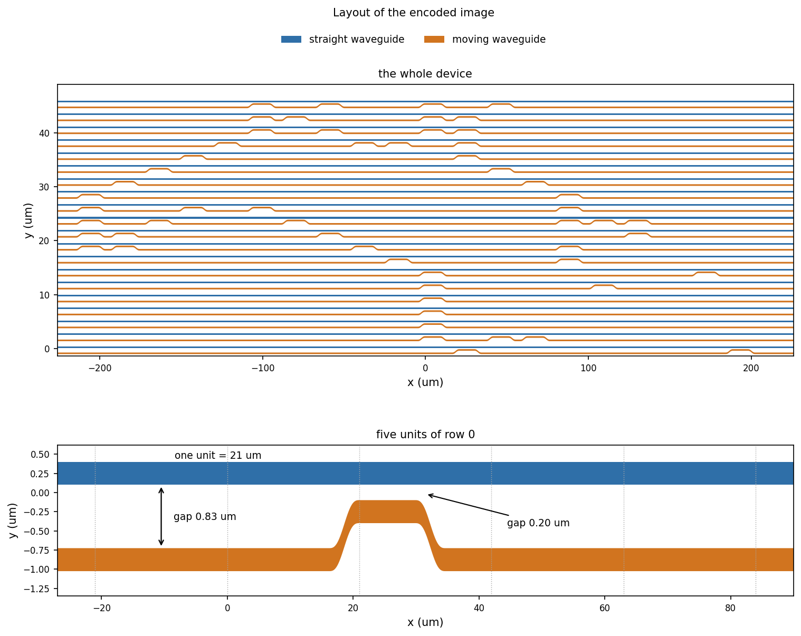
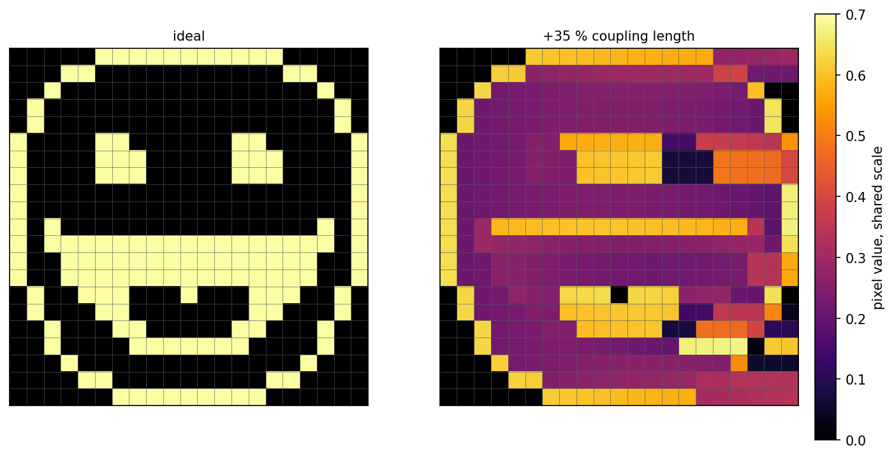
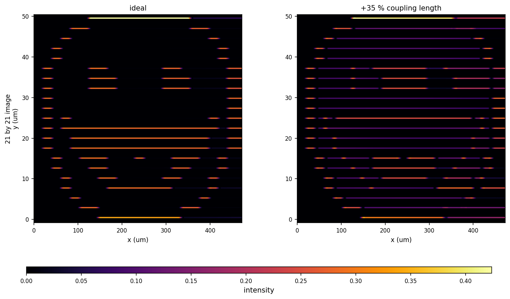
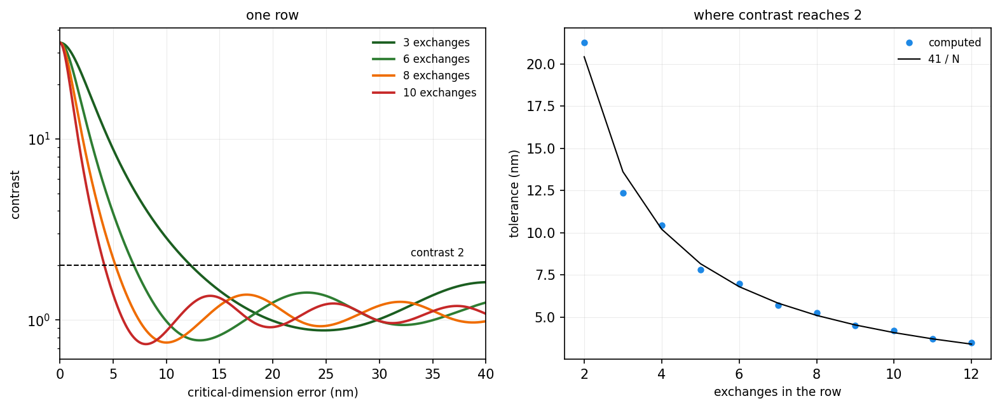

# waveguide-pixel-array

A coupled-waveguide pixel array for near-field image encoding.

A binary image is written into a photonic chip as the transverse position of
guided light. The image is read by looking at the near field above the chip.

Electronic chips have carried small pictures for decades: a dragon, a mascot, a
signature, drawn into the metal. Those pictures are part of the layout, so a
microscope shows them and nothing else is needed.

This repository is the same idea with the picture taken out of the layout. The
chip holds only waveguides. The picture is written into which waveguide the light
is using, and it appears when light is coupled in and the near field is imaged.
Nothing on the chip looks like the picture.

*Top row: a 20 by 20 image. Bottom row: a 21 by 21 image. Left: the simulated
near field, both waveguides. Right: the same field with everything but the
straight waveguide masked out. Each column has its own colour bar, in units of
the input power. The image is already there in the left column; masking the
moving waveguide makes it easier to look at, and is a reading option, not a
requirement.*

## What it is

The device is a silicon-on-insulator layout. Rows of exchange units sit 2.4
micrometres apart. One unit is one coupling section plus its two bends,
twenty-one micrometres long, and it writes one pixel of the image: the light
leaves it on whichever of the two waveguides the pixel value asks for. The 20 by
20 image therefore needs 400 units, and covers 420 by 48 micrometres; its device
is 452 micrometres wide. The 21 by 21 image covers 441 by 50.4 and its device is
473 wide. The extra 32 micrometres are access at the two ends.

*Top: the whole device. Bottom: five units of the first row, where the image
changes twice. Both vertical axes are stretched, so a 0.3-micrometre waveguide is
visible against a 2.4-micrometre row spacing. Where the image stays the same the
two waveguides stay apart; where it changes, the moving waveguide is pulled in to
the coupling gap and the light changes waveguide.*

The figure is drawn from the file that `encode_image.py` writes, so it always
shows what the encoder actually produced.

Each row is a pair of waveguides. Light enters on one of them. Where the image
changes from dark to bright, or from bright to dark, the two waveguides are
brought close over one unit, and the light swaps to the other waveguide. Where
the image stays the same, the two waveguides are kept apart and the light stays
where it is. The straight waveguide therefore carries the image, and the other
one carries its complement.

The image is not part of the shape of the chip. A microscope shows only
waveguides. Light must be coupled in, and the near field must be imaged. A
camera alone is not enough.

## Results

| | pixels correct | contrast |
|---|---|---|
| 20 by 20 image, 8.0 um | 400 of 400 | 216 x |
| 21 by 21 image, 8.66 um — taken as the reference | 441 of 441 | 241.8 x |
| same image, 10.8 um — 25 % longer than the reference | 283 of 441 | 2.7 x |

The percentages in the figure titles are relative to 8.0 micrometres, the length
the single-exchange calibration gave: 8.66 is 8.3 % more, 10.8 is 35 % more.
Measured against the reference, 10.8 is 25 % more.

`parameters.json` ships the reference length, 8.66 micrometres, so
`encode_image.py` and `simulate_row.py` build the middle row of the table. The
8.0 micrometre device used for the 20 by 20 image is one edit away: set
`unit.active_um` to 8.0.

With the reference device the two brightness groups do not overlap: the dimmest
bright pixel is 0.632 and the brightest dark pixel is 0.087, both in units of the
input power. For the 20 by 20 image the same two numbers are 0.568 and 0.166. A
single threshold separates the groups in either case, so the readout needs no
per-pixel calibration.

**Loss.** Each row leaves 98.6 % of its input power in its two output waveguides:
1.45 % lost along 452 micrometres, or 0.063 dB, of which less than 0.01 % comes
back as reflection. The worst of the twenty rows is 0.065 dB
(`data/port_powers.json`).

**Crosstalk.** One addressed row leaks 21.9 dB down into the row beside it, and
28.2 dB down into rows three or more away, both relative to that addressed row's
own output (`data/tile_crosstalk_from_map.json`).

**When the coupling length is wrong.** A device is only interesting if it
survives fabrication. The same image is shown below at three coupling lengths:

*Left: the image as drawn, one level for a bright pixel and one for a dark one.
Right: 10.8 micrometres, 35 % too long. Both panels share one colour scale, in
units of the input power; a measured bright pixel is about 0.65 of the input, not
1.0, because light that has moved onto the straight waveguide is dimmer than the
light entering the chip. The left panel is a drawing, the right one is measured.
The right panel reads 283 of 441 pixels correctly, contrast 2.7 times; it is a
reference for what failure looks like, not a specification.*

The same two states as field maps, on one scale:

*Left: the reference device. Right: 35 % too long. Only the straight waveguide is
kept, as in figure 2, so the image can be read in both. The right panel's rows are
lit almost everywhere, which is the contrast loss itself.*

## Tolerance

How far may the critical dimension drift before a row stops reading? Each
exchange is half a beat of coupling, so an error in the dimension becomes a phase
error, and the phase errors of a row add up. Counting them gives the curve below:

*Left: contrast of one row against critical-dimension error, for rows that make
3, 6, 8 and 10 exchanges. Right: the error at which the contrast falls to 2, as a
function of the number of exchanges.*

The result is a rule of thumb, **not a validated prediction**:

> the critical dimension may be off by about **40.8 / N nanometres**, where N is
> the number of exchanges in that row, before the row's contrast falls to 2.

The two levels and the contrast at zero error (34 times, from the 20 by 20 image)
are measured; the shape of the curve is geometry. Nothing here was checked
against a device built to a known error, and the 40.8 is not offered as a
guarantee — only as the simplest statement of what the geometry says.
`python plot_tolerance.py` recomputes it from `data/readout_dino.npz` in under a
second.

## Reproduce it

    python reproduce.py

That reads the files in `data/`, recomputes every number quoted above, and
prints `all checks passed`. It needs numpy and nothing else: no wave solver, no
licence, about a second.

## Encode an image

    python encode_image.py images/example.txt

This writes `out/example_geometry.json`, which holds every polygon of both
waveguides of every row, in micrometres. It needs numpy only.

    python plot_geometry.py

then draws that file and writes `figures/fig1_layout_v4.png`, the figure at the
top of this page.

An image is a text file, one line per row, `#` for a bright pixel and `.` for a
dark one. `images/example.txt` is the 20 by 20 image of figure 2;
`images/smile.txt` is the 21 by 21 one used in figures 3 and 4.

Figures 2 to 5 are drawn from the shipped data by:

    python plot_field_pair.py
    python make_figure.py ideal smile_e350 --out figures/fig3_degraded_v2.png
    python plot_field_compare.py
    python plot_tolerance.py

## Simulate a row

    python simulate_row.py --row 0

One row takes about twenty minutes on one processor. This step needs Ansys
Lumerical FDTD, which is commercial and needs a licence. Without it the script
says so and stops.

## Read an image back

    python read_image.py data/readout_dino.npz images/example.txt

A pixel is the mean of the intensity over the middle eight micrometres of the
pixel, taken across the straight waveguide, in units of the input power. The
middle is used so that the ramps at either end of a pixel do not enter the
number. The window and the threshold are in `parameters.json`.

## What is in here

    encode_image.py      image -> polygons
    plot_geometry.py     polygons -> the layout figure
    plot_field_pair.py   two images -> figure 2
    plot_field_compare.py  the reference against 35 % off -> figure 4
    plot_tolerance.py    the tolerance curve -> figure 5
    simulate_row.py      polygons -> one row of a wave simulation
    read_image.py        simulated data -> pixel values
    make_figure.py       the same image in two states, figure 3
    reproduce.py         every quoted number, from data/
    parameters.json      every dimension, in one place
    images/              two images
    data/                pixel values and port powers behind the figures
    figures/             the figures
    checks/              scripts used to look for weak rows and crosstalk

Every dimension the encoder and the simulation use is in `parameters.json`.

`data/` holds the per-pixel values, the port powers, the two assembled fields
behind figure 2, and the geometry that was simulated
(`geometry_20x20_simulated.json`). The fields there are decimated by two for display,
about 1.3 MB each; the per-row field dumps they came from are 28 MB each and are
not included.

## Boundaries

- The results come from a two-dimensional model.
- The design rule is for one wavelength, 1550 nanometres.
- The image is fixed at fabrication. A different image needs a different layout.
- Reading the image needs near-field or high-numerical-aperture imaging.

## Author

Chan King Ho.

## Licence

Code under MIT. Data and figures under CC BY 4.0.

